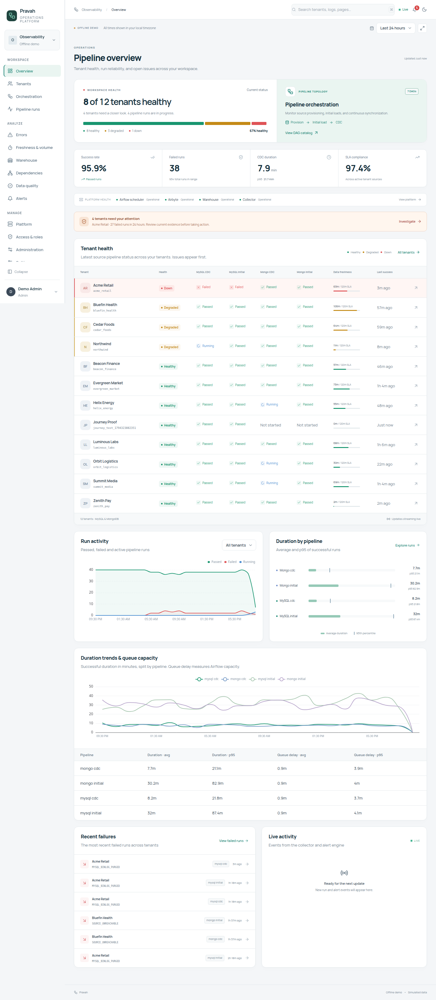
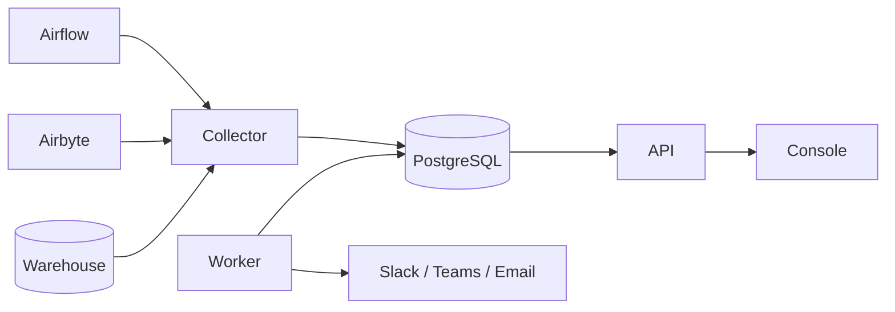

# Pravah

**Warehouse observability for multi-tenant Airbyte and Airflow pipelines.**



Pravah follows every sync from source to warehouse:

- It shows which tenants are healthy and which aren't.
- It explains why a sync failed, in plain language.
- It tracks how fresh each tenant's data is against its SLA.
- It raises one clear incident when something needs attention.

Your team can retry, resync and onboard tenants from the same screen, without logging in to production systems.

## What it does

- **Tenant health at a glance.** A live board of every tenant and pipeline (MySQL and MongoDB, initial load and CDC), with freshness against each tenant's SLA and a one-sentence status at the top.
- **Failures explained.** Every failure is classified, grouped by root cause and paired with the fix. Redacted logs, attempt history and run comparison sit next to it.
- **Incidents, not alert noise.** Related alerts become one incident, routed to Slack, Teams or email, with acknowledgement, escalation, maintenance windows and a daily digest.
- **Safe operator actions.** Retry, resync, pause and bulk retry are role-gated, confirmed, idempotent and fully audited.
- **Guided tenant onboarding.** Pre-flight checks for CDC readiness, automated provisioning of the Airbyte sources and connections, and a tenant isolation check before go-live.
- **Freshness, volume and schema.** SLA compliance, breach forecasts, row-count anomalies and schema drift, per table.
- **Data quality and dependencies.** Built-in checks, including tenant isolation for shared sources, and a map of what's affected downstream when something breaks.
- **Built for every screen.** Light and dark themes, a TV mode for the office display, and a mobile layout for on-call.

## How it works



- **The collector** reads Airflow, Airbyte and warehouse metadata with read-only credentials. It links each Airflow task to its Airbyte job, classifies and redacts failures, and stores everything in PostgreSQL.
- **The API** serves the console and streams live updates.
- **The worker** evaluates alert rules, groups alerts into incidents, delivers notifications, and runs quality checks.

Full details are in [`SPEC.md`](SPEC.md).

## Try it

```bash
cp .env.example .env
make install
make demo
```

Open <http://localhost:8080> and choose **Explore the demo**. The demo runs entirely offline on a seeded, live-updating dataset that covers these scenarios:

- A lost CDC position and its resync.
- A stuck sync.
- A volume drop and a schema change.
- Failures inside a maintenance window.
- A complete tenant onboarding.

The demo accounts for each role are listed in [`docs/configuration.md`](docs/configuration.md#demo-mode).

## Deploy

| Target | Guide |
|---|---|
| EC2 (Docker Compose) | [`docs/deployment.md#ec2`](docs/deployment.md#ec2) |
| Kubernetes (Helm on EKS) | [`docs/deployment.md#eks`](docs/deployment.md#eks) |
| Static frontend with an API proxy | [`docs/hosting.md`](docs/hosting.md) |

Requirements:

- PostgreSQL 16.
- Airflow 2.x, 3.x or Amazon MWAA.
- Airbyte OSS or Cloud.
- A Redshift or PostgreSQL warehouse (Snowflake and BigQuery through adapters).
- An OIDC identity provider for single sign-on.

## Security

- Single sign-on with OIDC and role-based access: Viewer, Operator, Admin.
- Server-side sessions, CSRF protection, a strict Content Security Policy, and rate-limited authentication.
- Read-only collector credentials, with write credentials kept separate and used only for audited operations.
- Secrets are read from AWS Secrets Manager or Vault and never stored or shown.
- Logs and error text are redacted before storage, and an append-only audit log covers every action.

More in [`docs/security.md`](docs/security.md).

## Documentation

| Document | Contents |
|---|---|
| [`SPEC.md`](SPEC.md) | Product specification |
| [`docs/DESIGN.md`](docs/DESIGN.md) | Design system and screens |
| [`docs/architecture.md`](docs/architecture.md) | Components and data flow |
| [`docs/configuration.md`](docs/configuration.md) | Runtime settings and demo mode |
| [`docs/deployment.md`](docs/deployment.md) | Deployment targets and upgrades |
| [`docs/operations.md`](docs/operations.md) | Running the console: monitoring, backups, restore |
| [`docs/security.md`](docs/security.md) | Authentication, access and data protection |
| [`docs/api.md`](docs/api.md) | API reference and OpenAPI schema |
| [`airflow/dags/README.md`](airflow/dags/README.md) | Onboarding DAGs and registry-driven scheduling |
| [`CHANGELOG.md`](CHANGELOG.md) | Release history |

## Development

See [`AGENTS.md`](AGENTS.md) for conventions, commands and the definition of done. Run `make lint`, `make test` and `make e2e` before opening a pull request.

## License

Proprietary. All rights reserved.
