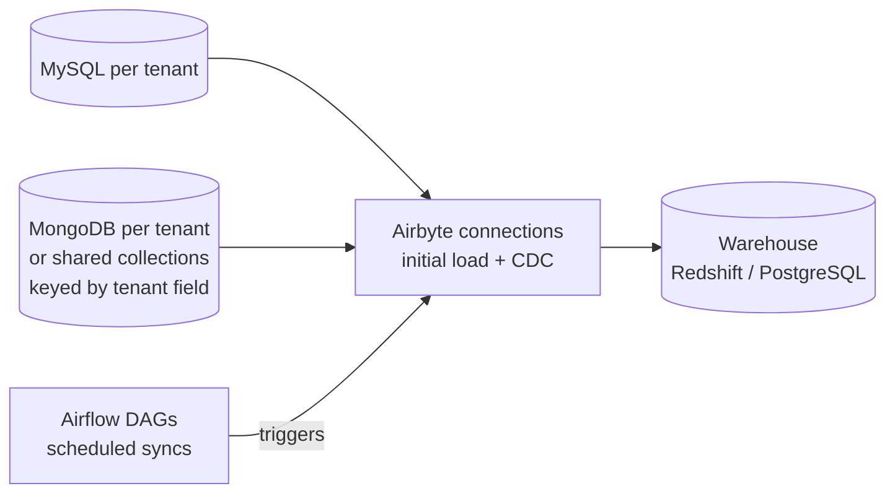
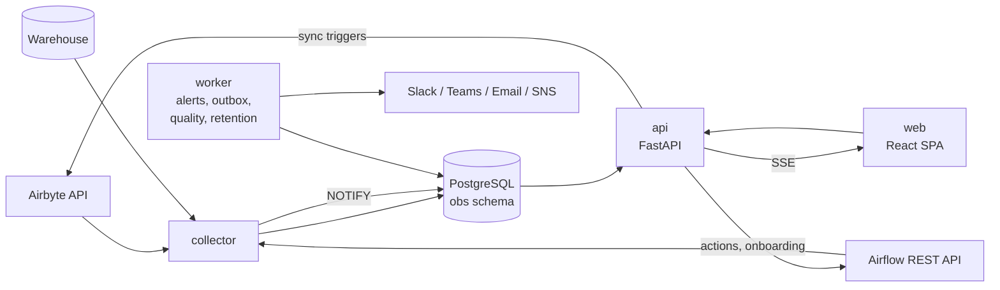

# Pravah: product specification

Version 3.0. This file is the source of truth for this repository. Visual design and screen behavior live in [`docs/DESIGN.md`](docs/DESIGN.md), which is part of this specification.

---

## 1. Product

Pravah is the control room for multi-tenant ELT pipelines built on Airbyte and Airflow. It does five things:

- Captures every sync, from source to warehouse.
- Explains failures in plain language.
- Tracks data freshness against each tenant's SLA.
- Monitors warehouse tables for freshness, volume and schema changes.
- Raises and routes incidents.
- Lets operators recover runs and onboard tenants, all without direct access to production systems.

### 1.1 Who it's for

| Person | What they get |
|---|---|
| Data engineers and on-call | Failures surface in seconds, with the cause and the fix next to the run. Retry, resync and pause from the run page. Paged only when it matters. |
| Platform and SRE | Health of Airflow, Airbyte, the warehouse and the console itself. A metrics export for existing monitoring. |
| Support and account teams | Whether a client's data is fresh right now, and an SLA history that can be shared with the client. |
| Leadership and stakeholders | A one-sentence status, trends, and a TV view for the office screen. |

### 1.2 Goals

1. **One place to look.** Every tenant, pipeline, run, error and alert is visible on one screen, with drill-down from there.
2. **Read access without production access.** Viewers never need credentials for Airflow, Airbyte or the warehouse.
3. **Explain failures, don't just list them.** Every failure is classified, grouped and paired with a next step.
4. **Safe actions.** Every write is role-gated, confirmed, idempotent and audited.
5. **Onboarding in minutes.** A new tenant goes from form to monitored in one guided flow.
6. **Production grade** on security, reliability, accessibility and operability (§10, §11).

### 1.3 Out of scope for v3

- Authoring DAGs or Airbyte connections, beyond what onboarding provisions.
- Column-level SQL lineage.
- General-purpose log search across all systems.
- Billing and chargeback. Volume and cost estimates are in scope.

### 1.4 Pipeline model



- Each tenant has MySQL and/or MongoDB sources. Each source has an initial-load connection and a CDC connection in Airbyte.
- Airflow DAGs trigger the syncs on a schedule, hourly by default. DAG ids and the mapping from tenant to connection come from configuration.
- MongoDB can be dedicated per tenant, or shared, with collections partitioned by a tenant field. Shared sources get the tenant isolation check (§2.9).
- Warehouses: Redshift and PostgreSQL are first-class. Snowflake and BigQuery are supported through the warehouse adapter interface.

---

## 2. Capabilities

Each capability lists its behavior. Screen layouts are in `docs/DESIGN.md` §7.

### 2.1 Overview

- **A one-sentence status at the top**, generated from the current state. It names at most 3 problems, ordered by severity. Examples: "9 of 10 tenants are healthy. Acme Retail's MySQL data is 7 hours old because its CDC position was lost; it needs a resync." When nothing is wrong: "All 10 tenants are healthy and within SLA."
- **A KPI strip**, where each KPI shows its change against the previous period: tenant health (healthy, degraded and down), success rate, failed runs, share of time within SLA, active syncs, open incidents.
- **The tenant health board:** the latest run of every pipeline per tenant, freshness against SLA, and live sync state. Problems sort to the top.
- Open incidents and live activity.
- Runs over time, and duration by pipeline (average and p95).
- The recent failures table.

### 2.2 Tenants

- A list with health, 7-day success, SLA compliance, failures, average CDC duration, last success per source, and owner.
- **Tenant detail**, in tabs: Overview, Runs, Alerts, Quality, Config.
  - **Overview tab:** the run timeline, with maintenance windows and change markers; CDC duration against its baseline; freshness for each warehouse table; open incidents.
- Pause and resume a tenant, and manage its maintenance windows.

### 2.3 Runs

- **Runs explorer:**
  - Filters for tenant, status, pipeline, error class, date range and text. Filters live in the URL and can be saved as private views.
  - A column picker and density toggle; CSV export.
  - Clicking a row opens a quick-look drawer.
- **Run detail:**
  - Timing against the usual duration, and queue delay.
  - Rows, bytes and per-stream statistics.
  - The Airflow try and Airbyte attempts, shown as an attempts strip.
  - The classified error with a fix hint and runbook link.
  - The redacted log, with level filters, search, and "jump to first error".
  - The previous runs of the same pipeline.
- **Run compare:** two runs side by side, with differing fields highlighted and stream counts diffed.

### 2.4 Errors

- Every failure is classified (§5.3) and fingerprinted into an **error group**. The same root cause across many runs is one group, with a count, the tenants affected, first and last seen, and a 7-day trend.
- Charts: where failures happen (by stage), time to recover by tenant, and a heatmap of failures by hour and weekday.
- **Runbooks:** each error class has an editable fix hint and an optional runbook link. Admins edit them, and every edit records who made it and when.

### 2.5 Freshness, volume and schema

- Freshness is measured from the last successful CDC run per tenant and source. It's shown against the tenant SLA, with compliance over 24 hours and 7 days.
- **Volume anomalies:** sudden drops or spikes in row count, compared against a per-tenant baseline.
- **Schema changes:** columns added, removed or retyped, detected from column snapshots and shown with the diff.
- **SLA breach forecast:** "will breach SLA in about 25 min if the next run fails", computed from data age, the SLA and the next scheduled run.

### 2.6 Incidents and alerting

- Built-in alert rules (§7.1). Admins tune thresholds, severities and channels.
- **Incidents** group related alerts by tenant and source. One root cause produces one incident, one notification thread and one row in the UI.
- Acknowledge, resolve, assign and add notes. The resolve form asks for an optional root-cause category, which feeds a monthly chart of top causes.
- **Routing:** a default channel, plus optional per-tenant overrides. Unacknowledged critical incidents escalate after a configurable delay.
- **Maintenance windows** (recurring or one-off) and ad-hoc **silences**, each with a reason and expiry. Inside a window, no alerts fire, failures are tagged, and SLA compliance excludes the window.
- **Daily digest:** a morning summary to Slack or email covering overnight incidents, tenants at risk and the slowest pipelines.

### 2.7 Operator actions

- **Retry run:** clears the failed Airflow task, or triggers a new Airbyte sync for runs that weren't started by Airflow.
- **Resync:** runs a fresh initial load, then restarts CDC from the new position. Offered as the fix when a CDC position is lost.
- **Pause and resume a tenant:** registry-driven DAGs skip paused tenants.
- **Bulk retry** within one error group: a dry-run preview, at most 20 runs per batch, and refused for classes where a retry can't help.
- Every action is a durable operation (§8.1). It's role-gated, confirmed, idempotent and audited.

### 2.8 Tenant onboarding

- A guided wizard: tenant details, then sources, then pre-flight checks, then review.
- **Pre-flight checks** run before anything is created, and each failed check says how to fix it.
  - MySQL: `binlog_format = ROW`, `binlog_row_image = FULL`, binlog retention long enough to survive a weekend outage, replication grants, TLS and reachability.
  - MongoDB: a replica set or sharded cluster, change stream access, and the tenant field filter (for shared sources).
  - Warehouse: the destination namespace exists and is writable.
- **Provisioning** runs as an Airflow DAG:
  1. Create the Airbyte sources and run their connection checks.
  2. Create the initial-load and CDC connections.
  3. Register the tenant.
  4. Run the initial loads.
  5. Run the tenant isolation check.
  6. Activate the tenant.

  Progress streams live to the console and survives a page reload.
- Credentials are never entered in the console. Only secret-manager references are accepted, and only from approved path prefixes.

### 2.9 Data quality

- Built-in check types: null rate, duplicate key, accepted values, schema contract, and **tenant isolation**.
- **The tenant isolation check** applies to every table loaded from a shared source. It counts rows whose tenant field doesn't match the tenant that owns the schema.
  - It runs on a schedule, and after every initial load.
  - Any non-zero count raises a critical incident, and Mongo syncs for that tenant pause automatically when live actions are enabled.
  - A tenant can't be activated until its isolation check passes.
- Checks have a schedule, a result history, and a "Run now" button.

### 2.10 Dependencies

- A map from source, through Airbyte connection and DAG/task, to warehouse table. Configured links are drawn solid; observed links are dashed.
- Selecting an asset highlights everything downstream that a failure would affect.
- A list view is available as an accessible alternative to the graph.

### 2.11 Activity and audit

- **Activity timeline:** runs, incidents, actions, onboarding steps and quality results in one chronological feed, filterable by type, tenant and actor.
- **Audit log:** append-only and exportable. Every write records the actor, action, target, request id, and outcome.

### 2.12 Platform health and active syncs

- Status and 24-hour uptime for each component: Airflow scheduler, Airflow metadata DB, Airbyte server, warehouse, collector, alerter, notifier.
- Airflow pool usage and DAG import errors.
- **Active syncs**, shown in the header: running syncs with elapsed time against the usual time and an estimated progress bar. Stuck syncs come first.
- The **live connection state** is always truthful. When the event stream drops, the header shows "Reconnecting…" and the time of the last data.

### 2.13 Reports and integrations

- **Weekly SLA report** per tenant, as CSV and a printable page. It's opt-in per tenant, for sharing with clients.
- **Volume and cost view:** rows and bytes per day, warehouse storage growth, and the fastest-growing tables. Costs are estimated from configured unit prices and labelled as estimates.
- A **Prometheus `/metrics`** export of tenant health, data age, failures and run durations.
- **Read-only API tokens:** scoped, revocable, and audited.

### 2.14 Viewing modes

- **TV mode:** dark theme, larger type, a clock, and optional rotation between Overview and Incidents.
- **Mobile:** tenant cards in place of the wide board, stacked table rows, and sticky action bars.
- Light and dark themes, local or UTC time, and comfortable or compact density, all remembered per user.

---

## 3. Architecture



| Component | Tech | Responsibility |
|---|---|---|
| `web` | React + TypeScript + Vite, Radix UI, TanStack Query and Table, one chart library | The console. Served as static files by nginx, which also proxies `/api`. |
| `api` | Python 3.12, FastAPI, psycopg 3 | The read API, authentication and sessions, RBAC, operator actions, onboarding, the SSE stream (it `LISTEN`s on Postgres) |
| `collector` | Python 3.12, httpx, APScheduler | Polls Airflow, Airbyte and the warehouse. Links, classifies, redacts and upserts. Sends `NOTIFY`. |
| `worker` | Python 3.12 | Alert evaluation, incident grouping, the notification outbox, quality checks, digests, retention |
| `db` | PostgreSQL 16 | The observability store (schema `obs`) |

Design decisions:

- **Credentials stay server-side.** Only `collector`, `api` and `worker` hold credentials for external systems; the browser talks only to `/api`.
- **Idempotent ingest.** Every write is an upsert on natural keys, so any process can restart at any time.
- **Singleton jobs use Postgres advisory locks** (collector polling, alert evaluation, retention). Any service can run multiple replicas safely; exactly one holds each lock.
- **Live updates** flow collector → `NOTIFY` → api → SSE → browser. There's no separate message broker.
- **Independence from Airflow.** The collector and worker run outside Airflow, so the console reports correctly while Airflow is down.
- **Supported topologies:**
  - A single VM with Docker Compose.
  - Kubernetes with the Helm chart.
  - The AWS reference: EKS or ECS, RDS PostgreSQL, Secrets Manager, ALB with ACM.
- **The frontend can be served from a CDN** with `/api` proxied to the API origin. The SSE route (`/api/v1/stream`) needs a proxy that supports long-lived streaming responses; otherwise, point the browser at the API origin for the stream.

---

## 4. Data model (PostgreSQL, schema `obs`)

Migrations are forward-only SQL files in `sql/migrations/`, applied by `python -m obs.migrate` as a pre-deploy job. Schema changes follow expand, then migrate, then contract, so deploys need no downtime.

### 4.1 Core tables

```sql
create table obs.tenants (
  tenant_id            text primary key,
  display_name         text not null,
  status               text not null default 'onboarding'
                       check (status in ('onboarding','active','paused','offboarded')),
  sources              jsonb not null default '{}',   -- {"mysql":{...},"mongo":{"shared":true,"tenant_field":"tenant_id"}}
  airbyte_connections  jsonb not null default '{}',   -- {"mysql_initial":"<uuid>","mysql_cdc":"<uuid>",...}
  warehouse_schema     text not null,
  freshness_sla_min    integer not null default 120,
  owner_email          text,
  alert_channel_id     text,                          -- optional routing override
  size_class           text not null default 'M' check (size_class in ('S','M','L')),
  registered_at        timestamptz not null default now(),
  updated_at           timestamptz not null default now()
);

create table obs.pipeline_runs (
  run_key               text primary key,  -- '<dag_id>|<dag_run_id>|<task_id>|<map_index>' or 'airbyte|<job_id>'
  tenant_id             text not null references obs.tenants(tenant_id),
  source_type           text not null check (source_type in ('mysql','mongo')),
  load_type             text not null check (load_type in ('initial','cdc')),
  status                text not null check (status in ('queued','running','success','failed','cancelled','skipped')),
  failed_stage          text check (failed_stage in ('airflow','airbyte','warehouse')),
  triggered_by          text not null default 'schedule',   -- schedule | manual | retry | resync | onboarding
  in_maintenance        boolean not null default false,
  scheduled_for         timestamptz,
  queued_at             timestamptz,
  started_at            timestamptz,
  ended_at              timestamptz,
  duration_s            integer,
  queue_delay_s         integer,
  rows_synced           bigint,
  bytes_synced          bigint,
  dag_id                text,
  dag_run_id            text,
  task_id               text,
  map_index             integer not null default -1,
  try_number            integer,
  airbyte_connection_id text,
  airbyte_job_id        bigint,
  airbyte_attempts      integer,
  operation_id          uuid,                -- set when started by a console action
  collected_at          timestamptz not null default now()
);
create index on obs.pipeline_runs (tenant_id, started_at desc);
create index on obs.pipeline_runs (status, started_at desc);
create index on obs.pipeline_runs (started_at desc);
create index on obs.pipeline_runs (airbyte_job_id);

create table obs.error_groups (
  fingerprint     text primary key,
  error_class     text not null,
  sample_message  text,
  first_seen      timestamptz not null,
  last_seen       timestamptz not null,
  occurrences     integer not null default 1
);

create table obs.run_errors (
  run_key        text primary key references obs.pipeline_runs(run_key) on delete cascade,
  tenant_id      text not null,
  stage          text not null,
  failure_origin text,
  failure_type   text,
  error_class    text not null,
  severity       text not null,
  fingerprint    text references obs.error_groups(fingerprint),
  error_message  text,                    -- redacted, at most 2 KB
  created_at     timestamptz not null default now()
);

create table obs.run_logs (
  run_key   text primary key references obs.pipeline_runs(run_key) on delete cascade,
  source    text not null check (source in ('airflow','airbyte')),
  content   text not null,                -- redacted, tail at most 512 KB
  tsv       tsvector generated always as (to_tsvector('simple', content)) stored
);
create index on obs.run_logs using gin (tsv);
```

### 4.2 Supporting tables

| Table | Purpose | Key columns |
|---|---|---|
| `run_stream_stats` | Per-stream counts | run_key, stream_name, records, bytes |
| `warehouse_snapshots` | Row count and last load per table | tenant_id, table_name, row_count, last_loaded_at, checked_at |
| `schema_snapshots` | Column sets for drift detection | tenant_id, table_name, columns jsonb, columns_hash, checked_at |
| `platform_health` | Component status history | component, status (up / degraded / down), details, checked_at |
| `collector_state` | Watermarks and heartbeats | component, watermark, last_success_at, last_poll_ms, last_error |
| `incidents` | Grouped alerts | id, tenant_id, source_type, severity, state (open / acknowledged / resolved), title, cause_rule, opened_at, acknowledged_by/at, resolved_by/at, assignee, root_cause_category |
| `alerts` | Rule firings | id, incident_id, rule_id, fingerprint (unique while open), severity, state, title, details, first_fired_at, last_seen_at |
| `incident_notes` | Notes and timeline entries | incident_id, author, body, created_at |
| `alert_rules` | Built-in rule settings | rule_id, enabled, severity, params jsonb, channels |
| `notification_channels` | Delivery targets | channel_id, kind (slack / teams / smtp / ses / sns), target_secret_ref, enabled |
| `notification_outbox` | Durable delivery | id, channel_id, payload, thread_key, state, attempts, next_attempt_at, lease_until, last_error |
| `maintenance_windows` | Planned quiet periods | id, tenant_id, rrule or start/end, timezone, reason, created_by |
| `silences` | Ad-hoc muting | id, scope (tenant, rule), reason, expires_at, created_by |
| `operations` | Durable operator actions | id (uuid), kind, target, idempotency_key (unique), requested_by, state (requested / running / succeeded / failed / needs_review), request, result, created_at, updated_at |
| `tenant_events` | Onboarding progress | tenant_id, step, status, message, at |
| `quality_checks` / `quality_results` | Data quality | check definition and schedule; result, value, threshold, ran_at |
| `dependency_edges` | Asset map | from_asset, to_asset, kind (configured / observed), evidence, last_seen |
| `runbooks` | Fix hints per error class | error_class, hint, url, updated_by, updated_at |
| `saved_views` | Private filters | user_id, page, name, query |
| `users` | Accounts | user_id, email (unique), display_name, role, status (active / invited / disabled), password_hash (argon2id, local auth only), last_sign_in_at |
| `roles` | Reusable workspace access bundles | name, base_level, permissions, description, created_by |
| `sessions` | Server-side sessions | id (hash), user_id, created_at, last_seen_at, expires_at, ip, user_agent, revoked_at |
| `password_reset_tokens` / `invites` | Account flows | token_hash, user_id or email, expires_at, used_at |
| `api_tokens` | Read API | id, name, token_hash, scopes, created_by, last_used_at, revoked_at |
| `audit_log` | Append-only record | id, at, actor, action, target, request_id, outcome, details |
| `app_settings` | Runtime settings | key, value, updated_by, updated_at |
| `modules` / `role_modules` / `user_module_overrides` | Product areas and server-enforced access | module_id, enabled, role grants, per-user grant or revoke |
| `warehouse_daily_rollups` / `platform_daily_rollups` | Long-term history after raw snapshots age out | day, tenant or component, aggregate counts and last state |

Pravah is the default module. HRMS, Finance and SAP are registry entries that stay disabled until those areas ship. The module picker returns only enabled modules the signed-in user can access. Admins manage assignments; a CEO or another named business role receives access through its module grants. The API checks module access on every route, so filtering the picker alone never grants or protects data.

Retention:

| Data | Kept for |
|---|---|
| Runs | 13 months, then daily rollups kept indefinitely |
| `run_logs` | 90 days |
| Snapshots and platform health | 30 days, then daily rollups |
| Audit log | 2 years |
| Outbox | 30 days after delivery |

Runs, warehouse snapshots and platform health are rolled into daily aggregates before high-resolution rows are removed. Daily rollups are retained indefinitely.

---

## 5. Collection

### 5.1 Poll loop (every `POLL_INTERVAL_SEC`, default 120)

1. **Airflow.** List DAG runs for the configured DAG ids updated since the watermark (with a 10-minute overlap), plus any run that hasn't finished. List their task instances. Sync tasks are identified by `SYNC_TASK_REGEX` or by operator class.
2. **Link to Airbyte.** Read the job id from the task's XCom `return_value`. If it's missing, use the Airbyte job on the same connection that started within ±5 minutes of the task. A linked job is never stored twice.
3. **Airbyte.** Fetch the status, duration, rows, bytes, attempts and stream stats of each linked job. Also list jobs per tenant connection, so syncs started outside Airflow are captured as `airbyte|<job_id>`.
4. **Resolve the tenant.** In order:
   1. The connection id in `tenants.airbyte_connections`.
   2. `TENANT_TASK_REGEX` on the task id.
   3. `rendered_map_index`.
   4. The stream namespace.

   Runs that still can't be resolved go to `_unmapped`, which is visible on the Platform page.
5. **Merge status.**
   - The run failed if either side failed.
   - `failed_stage` is `airbyte` when the job failed, and `airflow` when the task failed but the job succeeded or never started.
   - Failures inside a maintenance window are tagged `in_maintenance`.
6. **Enrich failures.** Take the Airbyte failure summary and the log tails, redact them (§5.4), classify and fingerprint them (§5.3), then upsert `run_errors`, `error_groups` and `run_logs`.
7. **Notify.** Send `NOTIFY run_events` with a compact payload (under 8 KB) after each batch.
8. **Bookkeeping.** Update the watermark, heartbeat and poll duration. A failure in one tenant or one call is recorded and the loop continues.

Every `PLATFORM_CHECK_SEC` (default 60), check:

- Airflow health, pools and import errors.
- Airbyte health.
- A warehouse ping.

Every `WAREHOUSE_CHECK_SEC` (default 900):

- **Row counts and last load times** come from catalog statistics, never `count(*)`:

  | Engine | Source |
  |---|---|
  | Redshift | `svv_table_info` |
  | PostgreSQL | `pg_class.reltuples` |
  | Snowflake | `information_schema.tables.row_count` |
  | BigQuery | `__TABLES__` |

- Column snapshots are taken at the same time. The load-time column is configurable (`_airbyte_extracted_at` or `_airbyte_emitted_at`).

### 5.2 Upstream APIs

**Airflow 2.x** (`/api/v1`) and **3.x** (`/api/v2`), behind one client interface. Supported auth:

- Basic auth through a gateway
- Bearer tokens
- AWS SigV4 for MWAA

Endpoints used:

- Batch DAG runs and task instances
- XCom `return_value`
- Task logs
- `/health`, `/pools` and `/importErrors`
- Write calls: `clearTaskInstances` and trigger DAG run. These use a separate credential, used only by `api` and `worker`.

**Airbyte:**

- The public API (`/api/public/v1`; `api.airbyte.com/v1` on Cloud) with application credentials. Used to list jobs, trigger syncs, and create sources and connections during onboarding.
- The config API (`/api/v1/jobs/get`), for attempt failure summaries and stream stats.
- `duration` is ISO-8601 and is parsed to seconds.

Contract tests use recorded, sanitized fixtures for each supported version. Tests never call live endpoints.

### 5.3 Error classification

Ordered regex rules live in `error_rules.yaml`; the first match wins. Each rule has a class, a severity, patterns and a default hint. Built-in classes:

- `MYSQL_BINLOG_PURGED` (critical)
- `MONGO_CHANGE_STREAM_LOST` (critical)
- `SOURCE_AUTH`
- `SOURCE_UNREACHABLE`
- `SCHEMA_CHANGE` (warning)
- `DESTINATION_ERROR`
- `OUT_OF_MEMORY`
- `AIRFLOW_INFRA`
- `TENANT_ISOLATION` (critical, raised by quality checks)
- `UNKNOWN`

When Airbyte reports `failureOrigin = destination`, the class is `DESTINATION_ERROR` even if no pattern matches.

**Fingerprint:** lowercase the message and replace numbers, UUIDs, hex ids, timestamps, IPs and quoted values with placeholders. Then hash `error_class` together with the normalized message (sha1). `python -m obs.collector.classify --replay` re-classifies stored errors after the rules change.

### 5.4 Redaction

Applied before anything is stored, and again on every API response that carries log or error text. It masks:

- Passwords and tokens.
- JWTs.
- Credentials embedded in connection URIs.
- Cloud access keys.
- Email addresses (except user emails in account screens).

It has unit tests with realistic samples.

---

## 6. Health and metrics

Metric definitions are shared by the API, alerts and reports, so the numbers never disagree between pages.

| Metric | Definition |
|---|---|
| Success rate | success ÷ (success + failed) in the range. Cancelled and skipped runs are excluded. |
| Duration avg / p50 / p95 | Successful runs only, per source and load type |
| Queue delay | `started_at − queued_at`: avg and p95 |
| Data age | Now − end of the last successful CDC run, per tenant and source |
| SLA compliance | Share of 5-minute buckets where data age ≤ SLA. Buckets before the tenant registered, and inside maintenance windows, are excluded. |
| MTTR | Failure end to the next success of the same tenant, source and load type |
| Baselines | Per tenant, pipeline and hour of day: median and median absolute deviation over 4 weeks. Falls back to a 7-day median when history is short. |

**Tenant health:**

- **Down:** the latest CDC run of any source failed; or data age is over the SLA; or there has never been a successful CDC run; or the isolation check is failing.
- **Degraded:** any failure in the last 24 hours outside maintenance; or data age over 75% of the SLA; or a stuck run; or an open warning-level incident.
- **Healthy:** otherwise.
- **Onboarding** and **paused** tenants are shown separately and aren't scored.

**Stuck run:** elapsed time beyond the baseline (median + 4 × MAD, and at least 3 × median). Runs in a retry-with-backoff state are excluded.

---

## 7. Alerting and incidents

### 7.1 Built-in rules

| Rule | Fires when | Default | Severity |
|---|---|---|---|
| `cdc_position_lost` | Latest CDC failure is a position-lost class | | critical |
| `tenant_isolation_breach` | Isolation check finds foreign rows | | critical |
| `cdc_consecutive_failures` | Last N CDC runs failed | n = 2 | high |
| `freshness_breach` | Data age over the SLA | 100% | high |
| `freshness_at_risk` | Forecast breach before the next scheduled run | off | medium |
| `stuck_run` | Run beyond its baseline (§6) | | medium |
| `volume_anomaly` | Row count outside the baseline band | 30% drop | medium |
| `schema_drift` | Column set changed | | low |
| `queue_backlog` | p95 queue delay too high for an hour | 15 min | medium |
| `dag_import_errors` | Airflow reports an import error | | high |
| `platform_down` | A component is down for 2 consecutive checks | | critical |
| `collector_silent` | No successful poll for too long | 10 min | critical |

### 7.2 Lifecycle

- The worker evaluates every rule every `ALERT_INTERVAL_SEC` (default 60).
- **Alert fingerprints:** an alert's fingerprint is `rule|tenant|source|…`, and only one alert per fingerprint is open at a time.
- **Grouping into incidents:** alerts for the same tenant and source join one incident.
  - The incident's cause comes from its most specific rule, in this order: position lost or isolation breach, then consecutive failures, then freshness, then the rest.
  - Severity is the highest among its alerts.
- **Notifications** go out once per incident. Updates are threaded (Slack thread or email reply), and a resolve notice is sent when the incident closes.
- **Acknowledge:** stops repeat notifications. Repeats go out every `repeat_min` (default 240) while the incident is unacknowledged.
- **Resolve:**
  - Automatic when every alert in the incident clears.
  - Manual resolves stay quiet until the condition clears and comes back.
- **Escalation:** a critical incident unacknowledged after `ESCALATION_MIN` (default 15) notifies the escalation channel.
- **Suppression:** maintenance windows and silences suppress notifications. Firings are still recorded and tagged.

### 7.3 Delivery

- Delivery goes through the outbox. Channels: Slack, Microsoft Teams (Workflows webhooks), SMTP (TLS), SES and SNS.
- Each message is delivered at least once, with bounded retries, exponential backoff and lease recovery.
- Delivery status shows on each channel in Administration, and "Send test" reports the result.
- Outbound hosts must be on `NOTIFICATION_ALLOWED_HOSTS`.

---

## 8. Actions and onboarding

### 8.1 Durable operations

Every write to an external system is an `operations` row:

1. The API records the operation as `requested`, with an idempotency key built from the action, target and a short time bucket.
2. The worker executes it and moves it to `running`, then `succeeded` or `failed`.
3. If the outcome can't be confirmed (for example, a timeout after the request was sent), the operation becomes `needs_review`. It's never replayed automatically.

Rules:

- **Live switch:** writes require `LIVE_ACTIONS_ENABLED=true`. When it's false, actions are disabled in the UI with the reason shown.
- **Unsafe retries refused:** where the Airflow version can't target a single mapped task, the retry is refused.
- **Confirmation:** resync and pause require typed confirmation of the tenant id.

### 8.2 Registry-driven DAGs

The scheduled DAGs read active tenants from `obs.tenants` at runtime, in a `get_active_tenants` task, then `.expand()` the sync task over the result. `map_index_template` labels each mapped task with its tenant id. New, paused and resumed tenants take effect on the next run without a deploy. The DAGs never query the database at parse time.

`airflow/dags/` ships three things:

- The reference onboarding and provisioning DAGs.
- The `tenant_registry` helper.
- A step-by-step guide for adopting this pattern in existing DAGs.

### 8.3 Onboarding flow

1. **Wizard:** tenant details, sources, pre-flight (§2.8), review.
2. The API validates the input and the secret references (approved prefixes only), inserts the tenant as `onboarding`, and starts the provisioning DAG with an idempotency key.
3. The DAG runs the §2.8 steps and writes a `tenant_events` row for each step. The console streams them live.
4. Activation requires a passing tenant isolation check, for shared sources.
5. When provisioning succeeds, the tenant becomes `active` and appears on the Overview with its first runs.
6. When a step fails, the progress screen shows the step, the error and the fix. Resuming starts from the failed step.

---

## 9. API

Base path `/api/v1`. The OpenAPI schema is served at `/api/v1/openapi.json`, and the frontend types are generated from it (`make types`).

### 9.1 Conventions

- JSON only. Times are ISO-8601 UTC.
- Errors look like `{"error": {"code": "...", "message": "...", "request_id": "..."}}`.
- Lists are cursor-paginated (`?cursor=&limit=`, at most 200 items).
- Mutating requests require the CSRF header and an `Idempotency-Key`.
- Every response carries `X-Request-Id`.
- Rate limits: 600 requests per minute per user, and the stricter auth limits in §10.

### 9.2 Endpoints

| Area | Endpoints |
|---|---|
| System | `GET /health` (liveness), `GET /ready` (database + migrations), `GET /config` (public UI config), `GET /stream` (SSE events: `run.updated`, `incident.changed`, `onboarding.step`, `platform.changed`, `sync.active`) |
| Auth | `POST /auth/login`, `POST /auth/logout`, `GET /auth/oidc/start`, `GET /auth/oidc/callback`, `POST /auth/password/forgot`, `POST /auth/password/reset`, `POST /auth/invite/accept`, `GET /me`, `PATCH /me/preferences`, `POST /me/password`, `GET /me/sessions`, `DELETE /me/sessions/{id}` |
| Overview | `GET /overview?range=` (KPIs with deltas, status sentence, board, active syncs) |
| Tenants | `GET /tenants`, `GET /tenants/{id}`, `GET /tenants/{id}/timeline`, `GET /tenants/{id}/freshness`, `PATCH /tenants/{id}` (admin: SLA, owner, routing), `POST /tenants/{id}/pause`, `POST /tenants/{id}/resume` |
| Runs | `GET /runs` (filters, `format=csv`), `GET /runs/{key}`, `GET /runs/{key}/log`, `GET /runs/compare?a=&b=`, `POST /runs/{key}/retry`, `POST /runs/bulk-retry` (with `dry_run`) |
| Resync | `POST /tenants/{id}/sources/{source}/resync` |
| Errors | `GET /errors/groups`, `GET /errors/groups/{fingerprint}`, `GET /metrics/durations`, `GET /metrics/mttr`, `GET /metrics/failures-heatmap` |
| Freshness | `GET /freshness`, `GET /volume-anomalies`, `GET /schema-changes`, `GET /forecast` |
| Incidents | `GET /incidents`, `GET /incidents/{id}`, `POST /incidents/{id}/acknowledge`, `POST /incidents/{id}/resolve`, `POST /incidents/{id}/assign`, `POST /incidents/{id}/notes` |
| Alerting config | `GET/PUT /alert-rules/{id}`, `GET/POST/PUT /channels`, `POST /channels/{id}/test`, `GET/POST/DELETE /maintenance-windows`, `GET/POST/DELETE /silences`, `GET/PUT /runbooks/{class}` |
| Onboarding | `POST /onboarding/preflight`, `POST /onboarding`, `GET /onboarding/{tenant}`, `POST /onboarding/{tenant}/resume` |
| Quality | `GET/POST/PUT /quality/checks`, `POST /quality/checks/{id}/run`, `GET /quality/results` |
| Dependencies | `GET /dependencies`, `GET /dependencies/{asset}/impact` |
| Activity | `GET /activity` |
| Platform | `GET /platform` (components, uptime, pools, import errors, collector stats), `GET /operations`, `GET /operations/{id}` |
| Reports | `GET /reports/sla?tenant=&week=`, `GET /reports/volume` |
| Admin | `GET/POST /users`, `PATCH /users/{id}`, `POST /users/{id}/disable`, `POST /users/{id}/enable`, `POST /users/{id}/revoke-sessions`, `POST /users/{id}/send-reset`, `GET/POST/DELETE /api-tokens`, `GET /audit` (filters, CSV), `POST /demo/reset` (demo mode only) |
| Saved views | `GET/POST/DELETE /views` |
| Metrics | `GET /metrics` (Prometheus format; API token with the `metrics` scope) |

Unversioned `/api/*` routes from earlier builds stay as aliases until the frontend uses `/api/v1` everywhere. Then they're removed.

---

## 10. Security and access

### 10.1 Authentication

- **Production:** OIDC authorization code flow with PKCE.
  - One-time state and nonce.
  - The token's signature, issuer and audience are verified, and the email must be verified.
  - Roles come from an explicit group-to-role map (`OIDC_GROUP_ROLES`).
  - Password login is disabled in this mode.
- **Local accounts** (small installs and demo): argon2id hashes, the invite flow, password reset, change password, and lockout. Full flows are in `docs/DESIGN.md` §9.
- Live local password authentication stays disabled unless `ALLOW_LOCAL_AUTH_IN_LIVE=true` is set explicitly.
- **Sessions:**
  - Stored server-side, with an HttpOnly, Secure, SameSite=Lax cookie.
  - Idle timeout of 12 hours; absolute lifetime of 7 days.
  - Revocable by the user (per session) and by admins (all of a user's sessions).
  - A password change or reset revokes the user's other sessions.
- **Auth rate limits:**
  - Login: 10 failures per 15 minutes per account and per IP, then a 15-minute cool-down.
  - Reset requests: 5 per hour per email, 20 per hour per IP.
  - The same response is returned whether or not an account exists.

### 10.2 Roles

| Capability | Viewer | Operator | Admin |
|---|:-:|:-:|:-:|
| All monitoring and investigation views, exports, saved views | ✓ | ✓ | ✓ |
| Acknowledge, resolve, assign and annotate incidents | | ✓ | ✓ |
| Retry, bulk retry, resync, pause and resume | | ✓ | ✓ |
| Maintenance windows and silences; run quality checks now | | ✓ | ✓ |
| Onboard tenants | | ✓ | ✓ |
| Alert rules, channels, runbooks, quality check definitions | | | ✓ |
| Users, roles, API tokens, audit log, settings, demo reset | | | ✓ |

- The server enforces every row on every endpoint; the UI only reflects it (`docs/DESIGN.md` §8).
- Module access is separate from page permissions. Custom workspace roles can receive access to enabled product modules; per-user grants and revokes are audited and applied by the API. Admins can manage the registry and grants. A CEO is represented by an explicitly assigned role, not a hard-coded email or title.
- Nobody can change their own role, and the last admin can't be demoted or disabled.
- Admins can preview the UI as another role ("View as"). Preview is read-only and audited.

### 10.3 Application and data protection

- **HTTP security headers:**
  - A strict Content-Security-Policy: `default-src 'self'`, no inline scripts, `frame-ancestors 'none'`.
  - HSTS.
  - `X-Content-Type-Options: nosniff`.
  - `Referrer-Policy: same-origin`.
- **Request checks:** CSRF tokens on every mutating request; an Origin check against `CONSOLE_URL`.
- **Secrets:**
  - Read from AWS Secrets Manager or Vault at runtime.
  - Never stored in the database. Never logged. Never sent to the browser.
  - Tenant credentials are referenced by path, and only from `AWS_SECRET_PREFIX` (or its configured equivalent).
- **Least privilege:**
  - The collector uses read-only service accounts (Airflow viewer, Airbyte read, a warehouse catalog-read role).
  - Write credentials are separate and used only for operations.
- **Network:**
  - The database is private.
  - Outbound calls are restricted to the configured hosts.
  - Source pre-flight connections are allowed only to `SOURCE_ALLOWED_CIDRS`.
- **Personal data:** the only personal data stored is user names and emails. Pipeline logs are redacted before storage.
- **Repository scanning:** Gitleaks scans the full Git history on pull requests and main pushes, and a finding fails CI.
- **Supply chain:**
  - Dependencies are pinned and audited in CI.
  - Container images run as non-root, are scanned, have an SBOM, are signed, and are deployed by digest.

### 10.4 Configuration guards

The process refuses to start when:

- `MODE=live` is set together with `DEMO_PUBLIC=true`;
- `MODE=live` is set while demo users exist;
- `MODE=live` uses local password login without `ALLOW_LOCAL_AUTH_IN_LIVE=true`;
- `COOKIE_SECURE=false` is set outside localhost.

Every refusal exits non-zero with a clear message.

---

## 11. Reliability and operations

- **Health:**
  - `/api/v1/health` reports the process.
  - `/api/v1/ready` checks the database and that migrations are current.
  - Workers expose the same two checks on an internal port.
- **Graceful shutdown:** on SIGTERM, a process stops taking work, finishes its current batch (up to 30 s), releases its advisory locks, and exits.
- **Backups:**
  - RDS point-in-time recovery is the primary recovery mechanism.
  - A nightly encrypted `pg_dump` goes to S3.
  - A restore drill runs monthly into an empty database.
  - The restore tool refuses a target that already contains user tables.
- **Capacity targets** (verified by a load test in CI):
  - 200 tenants and 2 million retained runs.
  - List endpoints: p95 under 300 ms.
  - Overview: interactive in under 2 s.
  - SSE: 200 concurrent viewers.
- **Service objectives for the console:**
  - Availability of 99.5% monthly.
  - Data delay (pipeline event to console) under 5 minutes, measured continuously.
  - Alert evaluation within 2 minutes of the condition.
- **Self-observability:**
  - Every service exposes Prometheus metrics (request latency, poll duration, lag, outbox depth, lock ownership).
  - Logs are structured JSON with request ids.
  - OpenTelemetry tracing is optional.
  - CloudWatch alarm examples are included for the AWS reference deployment.
- **Runbooks for operating the console itself** live in `docs/operations.md`: collector lag, outbox backlog, failed migrations, restore, key rotation and session revocation.

---

## 12. Configuration

- Configuration comes from environment variables plus an optional YAML file (`CONFIG_FILE`) for structured mappings: DAG ids, tenant mappings, channels.
- Everything is validated at startup with pydantic-settings. Invalid configuration exits with a message naming the field.
- `.env.example` covers demo defaults and `.env.live.example` covers live. Both list every variable with a safe example value; `docs/configuration.md` documents each one.
- Key groups:
  - **Mode:** `MODE`, `DEMO_PUBLIC`, `ENVIRONMENT_NAME`.
  - **Console and auth:** `CONSOLE_URL`, `AUTH_PROVIDER`, `ALLOW_LOCAL_AUTH_IN_LIVE`, `OIDC_*`.
  - **Airflow and Airbyte:** `AIRFLOW_*`, `AIRBYTE_*`.
  - **Warehouse:** `WAREHOUSE_*`.
  - **Intervals:** `POLL_INTERVAL_SEC`, `PLATFORM_CHECK_SEC`, `WAREHOUSE_CHECK_SEC`, `ALERT_INTERVAL_SEC`.
  - **Switches:** `LIVE_ACTIONS_ENABLED`, `REGISTRY_DAGS_ENABLED`, `QUALITY_ENABLED`, `RETENTION_ENABLED`.
  - **Secrets and network:** `AWS_REGION`, `AWS_SECRET_PREFIX`, `SOURCE_ALLOWED_CIDRS`, `NOTIFICATION_ALLOWED_HOSTS`.

---

## 13. Demo mode

Demo mode ships with the product for evaluation, training and documentation. `MODE=demo` runs fully offline on a seeded dataset with live simulation. It makes no external calls, and every action is simulated end to end.

**Dataset:**

- 10 tenants with 7 days of hourly runs.
- Realistic durations (log-normal per tenant size), queue delays with an evening peak, and a 2–4% background failure rate across every error class.
- Per-stream stats, warehouse and schema snapshots, platform history, and quality results.

**Scenarios, present after every seed or reset:**

| Tenant | Scenario |
|---|---|
| `acme_retail` | MySQL CDC position lost for 6+ hours: down, one critical incident. A retry fails the same way; a resync recovers it and the incident resolves itself. |
| `bluefin_health` | Mongo CDC source unreachable, now retrying: degraded, with the SLA breach forecast showing. |
| `northwind` | A MySQL CDC run stuck at more than 3× its baseline: degraded, stuck-run alert. |
| `orbit_logistics` | A 40% row drop on `shipments` yesterday (acknowledged), and a new column on `orders`. |
| `cedar_foods` | Nightly failures inside a recurring 1–3 AM maintenance window: tagged, not alerted, excluded from the SLA. |
| `pinecrest_edu` | A resolved tenant-isolation incident from 3 days ago, with its quality check history. |
| Onboarding | The wizard pre-fills `zenith_pay`. Provisioning completes in about a minute, and the tenant turns healthy. |
| Platform | One DAG import error yesterday, fixed 19 minutes later. |

**The ticker** adds runs continuously, so the board, KPIs and activity feed visibly move.

**Accounts:**

| Account | Role |
|---|---|
| `admin@demo.local` | Admin |
| `operator@demo.local` | Operator |
| `viewer@demo.local` | Viewer |

The password is `DEMO_PASSWORD`. A dev mailbox (`/dev/mailbox`, admin only) shows invite and reset emails.

**Hosted demo (`DEMO_PUBLIC=true`):**

- "Explore the demo" signs visitors in as a read-only viewer.
- Each browser session gets its own sandboxed state, or the demo resets automatically every 2 hours; admins can also reset it on demand.
- A persistent demo banner shows the next reset time.
- Password reset is disabled for the shared demo accounts.
- The §10.4 guards apply.

---

## 14. Design

`docs/DESIGN.md` defines the design system and every screen:

- The tokens: color, IBM Plex type, spacing on a 12-column grid, radius, elevation and motion.
- The components, including active-sync motion.
- The layout and behavior of all 20 screens, including TV and mobile.
- The RBAC UI, the account flows, copy rules, the design review rubric and the visual quality gates.

The `/styleguide` route renders every token and component state.

---

## 15. Quality and delivery

### 15.1 Tests

| Layer | Covers |
|---|---|
| Unit | Classification, fingerprints, redaction, metric definitions, health logic, incident grouping, auth tokens, config guards |
| Contract | Airflow 2/3, MWAA and Airbyte clients against recorded, sanitized fixtures for each supported version |
| Integration | API against a real PostgreSQL. The RBAC matrix for every role. Auth flows. Outbox retries. Durable operations. Backup and restore round trip |
| End to end (Playwright) | The demo walkthrough (§13). Every screen in light and dark at 1440 and 390 px. axe accessibility. Layout stability during live updates |
| Load | Capacity targets (§11) against the demo dataset scaled up to 200 tenants |

### 15.2 CI pipeline (every pull request)

1. Lint and types: ruff, mypy, ESLint, tsc. Plus the token lint from `docs/DESIGN.md` §11.2.
2. Gitleaks scans the complete Git history and fails on any secret finding.
3. Unit, contract and integration tests.
4. Frontend build. Check that the OpenAPI-generated types match the committed ones.
5. e2e against `make demo`, including the visual regression and axe gates.
6. Dependency audit and container scan.

On merge to `main`: build the images, create the SBOM, sign the images, and push them by digest.

### 15.3 Releases

- Semantic versioning, with a `CHANGELOG.md` entry in every release PR.
- Promotion goes dev, then staging, then production, with the same image digests at each stage. Migrations run as a pre-deploy job.
- `docs/release-checklist.md` lists the release criteria, and each release records evidence against them:
  - Every CI gate is green.
  - On staging, 20 sampled runs match their Airflow and Airbyte records.
  - One onboarding completes end to end on staging, and the tenant isolation check passes.
  - One retry and one resync complete on staging.
  - SSO sign-in and an alert delivery succeed on the target identity provider and channel.
  - A restore drill completes on the target environment.
  - A rollback is rehearsed.

---

## 16. Repository and documentation

```
warehouse-observability/
├── README.md               product overview and quick start
├── SPEC.md                 this specification
├── AGENTS.md               engineering working agreement
├── CHANGELOG.md
├── docker-compose.yml  Makefile  .env.example  .env.live.example
├── config/                 live.example.yaml
├── sql/migrations/
├── backend/obs/            api/ collector/ worker/ auth/ actions/ onboarding/ quality/ demo/ shared/
├── frontend/src/           styles/tokens.css, components/, screens/, api/ (generated), styleguide/
├── airflow/dags/           onboarding + provisioning DAGs, tenant_registry, adoption guide
├── deploy/                 compose/ (single VM), helm/ (Kubernetes), aws/ (IAM, alarms examples)
├── scripts/                gallery, load test, restore drill
├── tests/                  backend/, contract/fixtures/, e2e/
└── docs/
    ├── DESIGN.md           design system and screens
    ├── architecture.md
    ├── configuration.md
    ├── deployment.md
    ├── operations.md
    ├── security.md
    ├── api.md              generated from OpenAPI
    ├── release-checklist.md
    └── screenshots/        gallery generated from demo mode
```

---

## 17. Build plan

The rebuild runs on the existing repository. Code that meets this spec and passes its tests stays; everything else is replaced. The frontend is rebuilt on the design system.

| Milestone | Scope | Done when |
|---|---|---|
| R0 Foundations | Repository layout (§16), CI pipeline (§15.2), config validation and guards (§10.4, §12), migrations runner | CI is green on an empty-feature build, and the guards are covered by tests |
| R1 Data model | All §4 tables and views, retention jobs, metric definitions (§6) with unit tests | `make reset` creates the schema; metric tests pass |
| R2 Collection | §5 in full, with contract fixtures for each supported version | Contract and integration tests pass; demo mode seeds through the same ingest path |
| R3 API and access | §9 endpoints, §10 auth, sessions, RBAC and account flows | The RBAC matrix and auth tests pass; the OpenAPI types are generated |
| R4 Design system | `docs/DESIGN.md` §3–§6: tokens, fonts, components, app shell, `/styleguide` | Every `/styleguide` state passes axe in light and dark |
| R5 Screens | `docs/DESIGN.md` §7, every screen | Each screen meets the DESIGN §12 definition of done |
| R6 Alerting and actions | §7 incidents and delivery, §8 operations and onboarding, §2.9 isolation check | The §13 scenarios behave as described end to end |
| R7 Demo | §13 dataset, scenarios, ticker, hosted demo isolation, dev mailbox | `make reset && make demo` reproduces every scenario; the hosted demo guards are tested |
| R8 Production readiness | §11 operations, deploy targets, observability, load test, docs set (§16) | The §15.3 release checklist is complete on staging |
