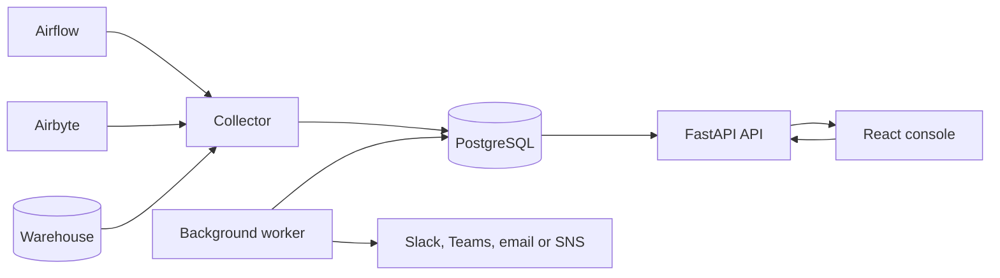

# Architecture

Pravah observes Airflow, Airbyte and warehouse metadata through server-side services. The browser communicates only with the Pravah API.

| Component | Responsibility |
|---|---|
| Web | Serves the React console and proxies API requests. |
| API | Authentication, sessions, authorization, reads, operator actions and live event delivery. |
| Collector | Polls Airflow, Airbyte and warehouse metadata; normalizes, redacts and stores observations. |
| Worker | Evaluates incidents, delivers notifications, runs quality checks and performs scheduled maintenance. |
| PostgreSQL | Stores observability data, durable operations, audit records and event notifications. |

The collector and worker run independently of Airflow. Database advisory locks coordinate singleton jobs across replicas. PostgreSQL `NOTIFY` and server-sent events deliver updates without a separate message broker.

Deployment options and network boundaries are described in [deployment](deployment.md). The complete component contract is in [SPEC §3](../SPEC.md#3-architecture).
