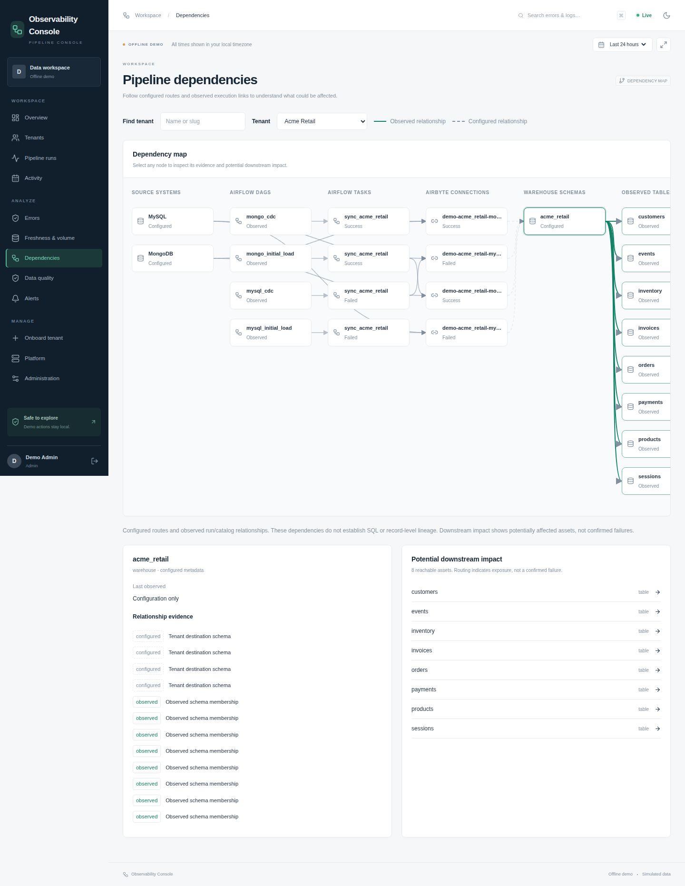
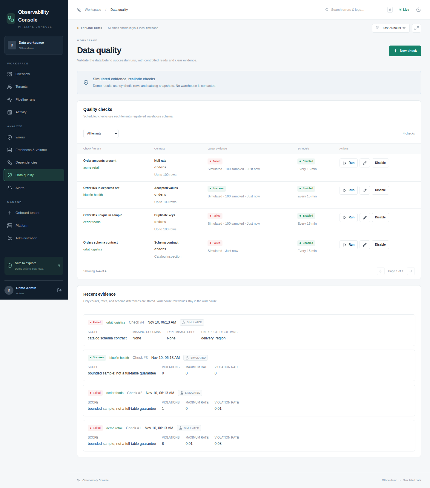
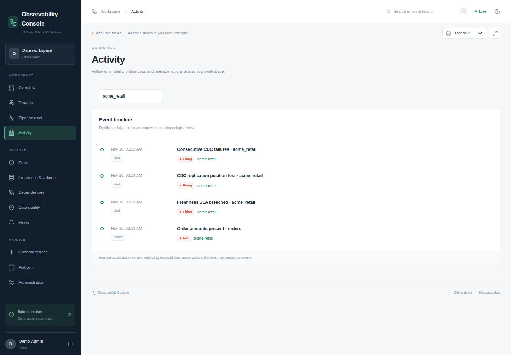
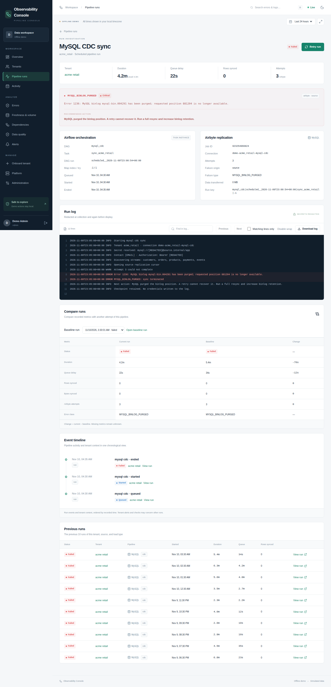
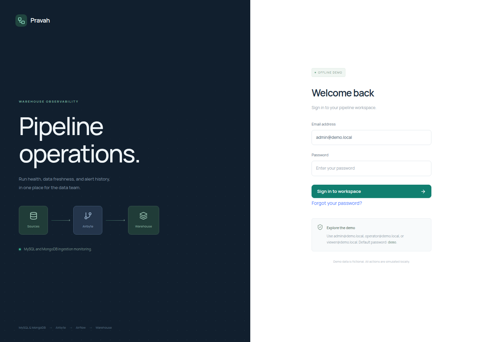

# Observability Console screens

Original Playwright captures of the offline demo. Live integration and EC2/EKS deployment code is included; real staging acceptance remains pending.

## Pipeline overview

Tenant health, KPIs, durations, failures, and live activity.

## Tenants

Client health, pipeline states, freshness, and service levels.

## Tenant investigation

Acme's CDC incident, timeline, metrics, and configuration.

## Pipeline runs

Filtered run explorer with pagination and CSV export.

## Run investigation

Classified error, recommended fix, and redacted log.

## Error intelligence

Root-cause groups, failure heatmap, and recovery metrics.

## Freshness & volume

Source SLAs, Orbit's volume drop, and schema drift.

## Pipeline dependencies

Configured routes, observed execution links, and potential downstream impact.

## Data quality

Sample-based checks, aggregate evidence, and result history.

## Activity

A chronological view of run, alert, onboarding, action, and quality events.

## Run comparison

Side-by-side run metrics and per-stream record differences.

## Alerts

Alert lifecycle, notification channels, and built-in rules.

## Onboarding

The guided setup flow and CDC pre-flight checks.

## Platform

Component history, Airflow pools, collectors, and database health.

## Administration

Users, roles, operation outcomes, notification deliveries, and audit history.

## Global search

Full-text search over classified errors and redacted logs.

## TV mode

Overview without navigation, for a shared office screen.

## Dark theme

The overview in dark mode.

## Mobile

Tenant health and service levels on a narrow viewport.

## Sign in

Local demo accounts with Viewer, Operator, and Admin roles.

