# Observability Console screens

Original Playwright captures of the M0–M4 offline demo. Live integrations remain at M5–M7.

## Pipeline overview

Tenant health, KPIs, durations, failures, and live activity.

[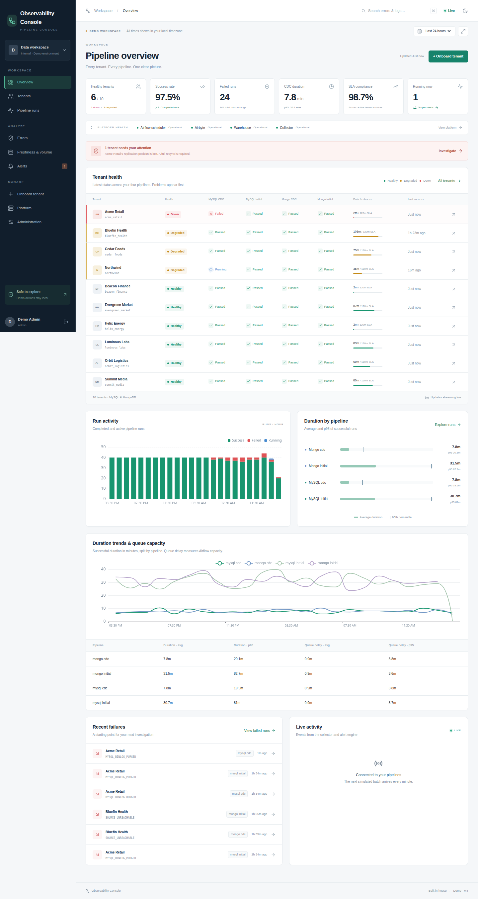](overview.png)

## Tenants

Client health, pipeline states, freshness, and service levels.

[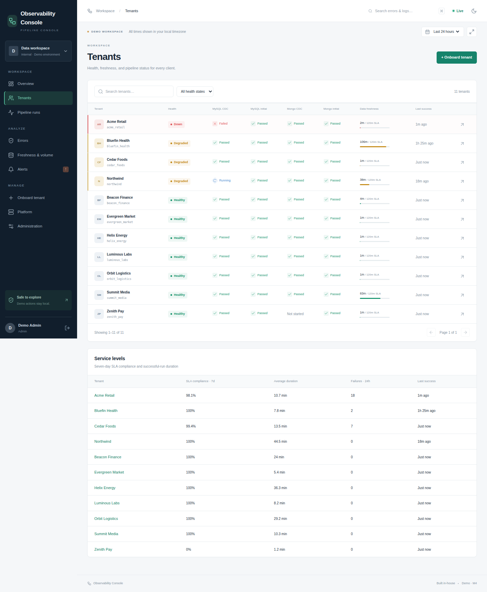](tenants.png)

## Tenant investigation

Acme's CDC incident, timeline, metrics, and configuration.

[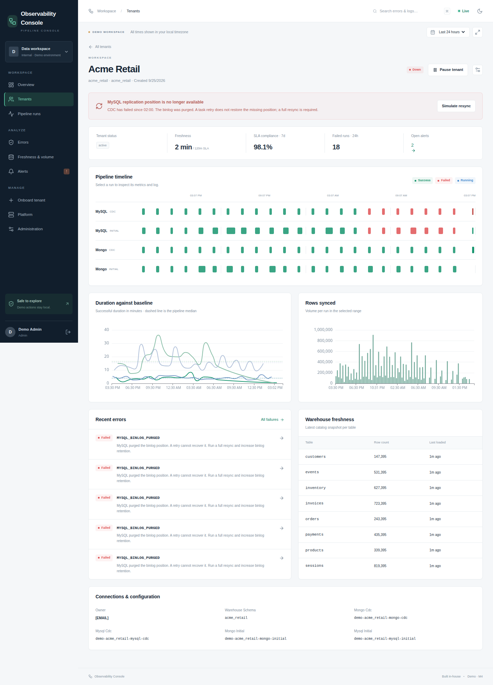](tenant-detail.png)

## Pipeline runs

Filtered run explorer with pagination and CSV export.

[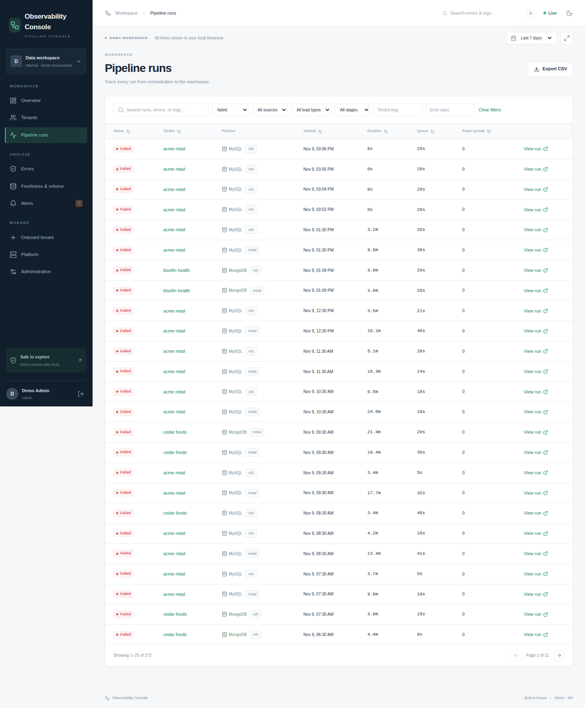](runs.png)

## Run investigation

Classified error, recommended fix, and redacted log.

[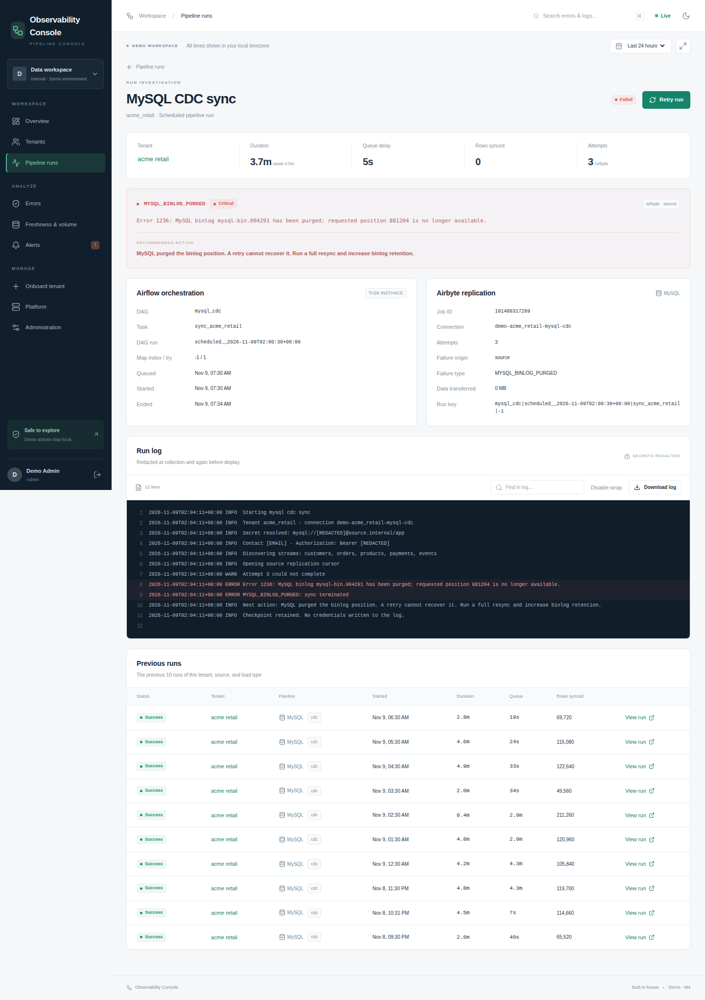](run-detail.png)

## Error intelligence

Root-cause groups, failure heatmap, and recovery metrics.

[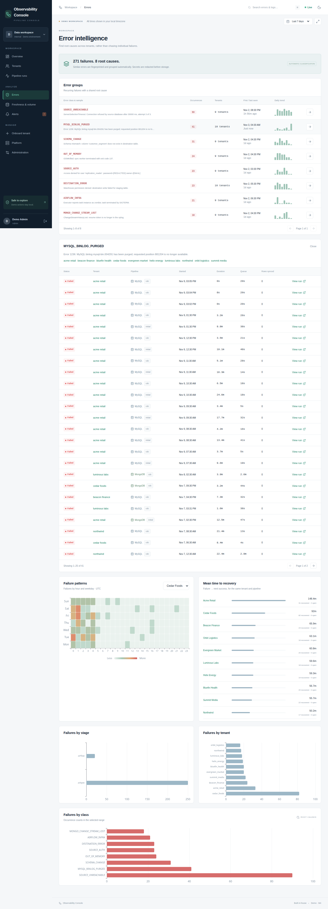](errors.png)

## Freshness & volume

Source SLAs, Orbit's volume drop, and schema drift.

[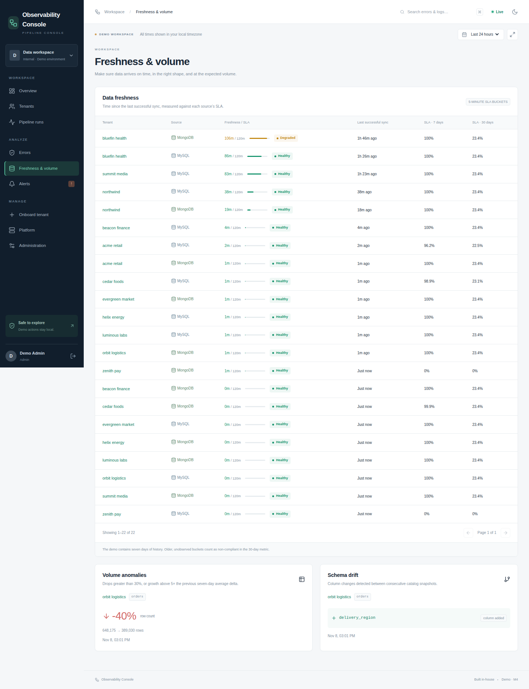](freshness.png)

## Alerts

Alert lifecycle, notification channels, and built-in rules.

[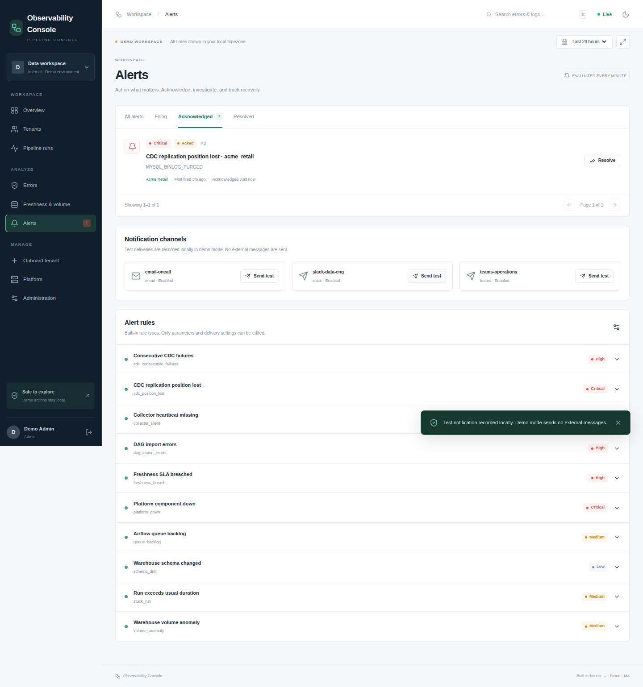](alerts.png)

## Onboarding

The guided setup flow and CDC pre-flight checks.

[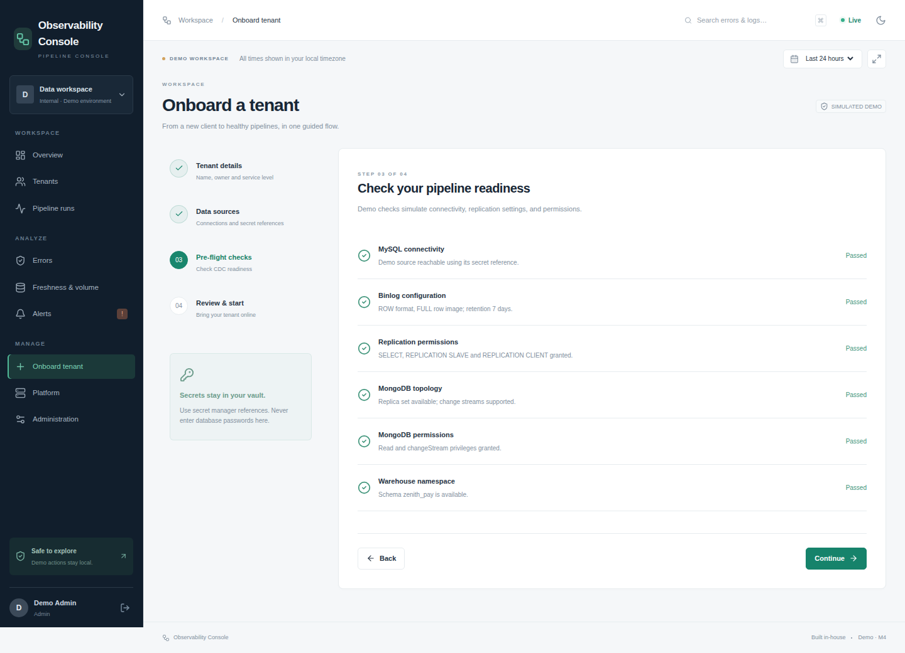](onboarding.png)

## Platform

Component history, Airflow pools, collectors, and database health.

[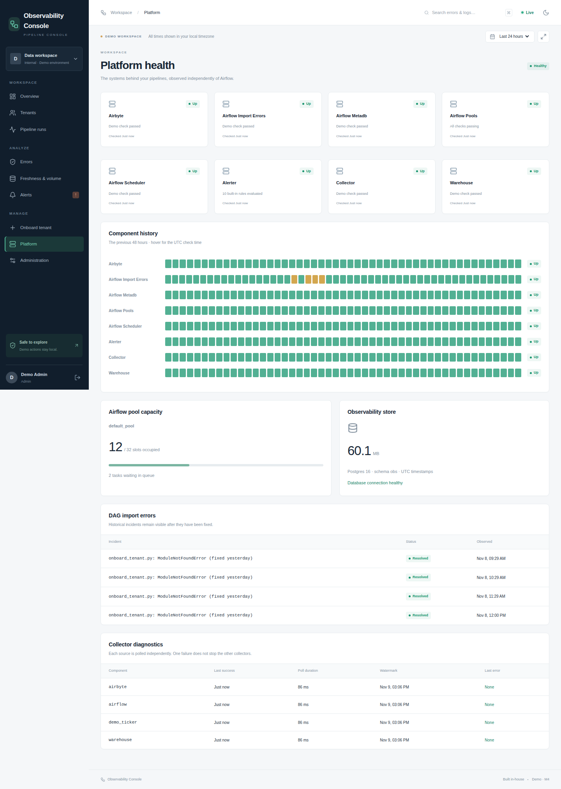](platform.png)

## Administration

Users, roles, and the audit trail.

[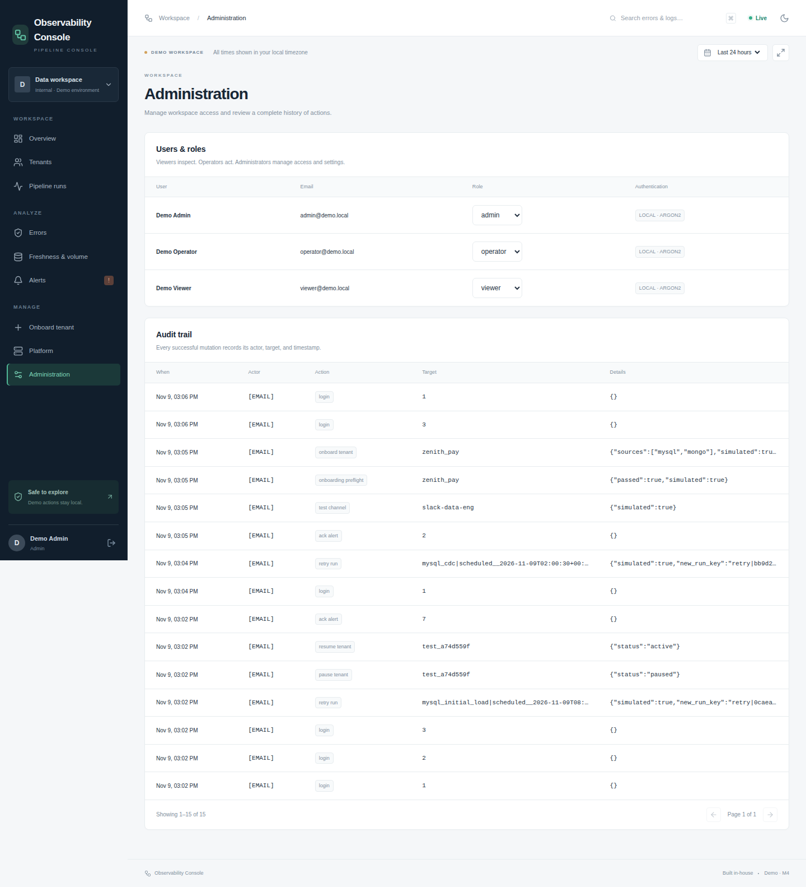](admin.png)

## Global search

Full-text search over classified errors and redacted logs.

[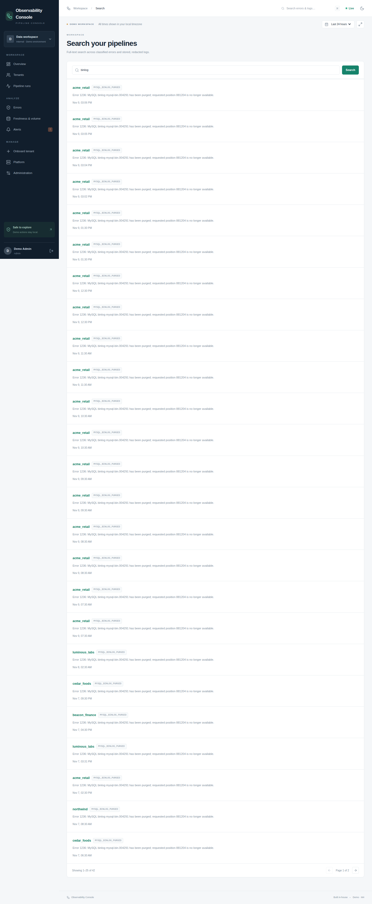](search.png)

## TV mode

Overview without navigation, for a shared office screen.

[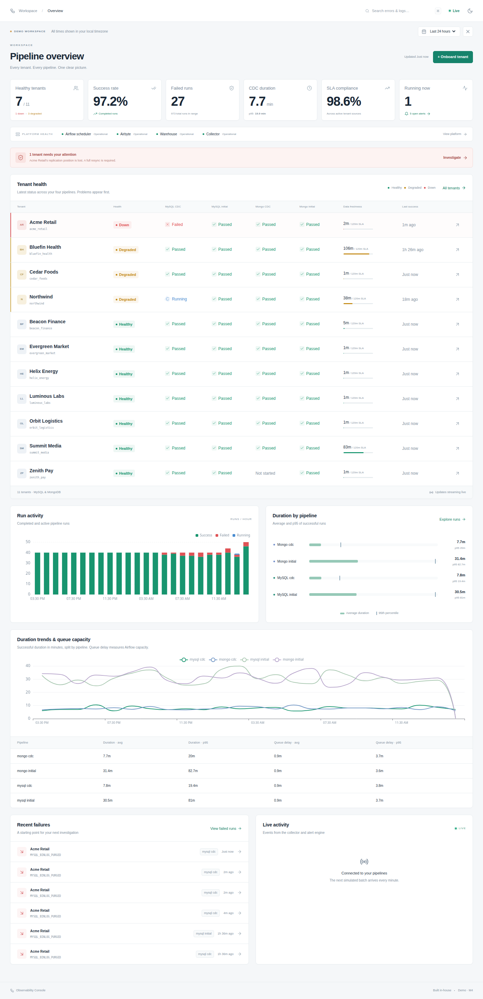](tv-mode.png)

## Dark theme

The overview in dark mode.

[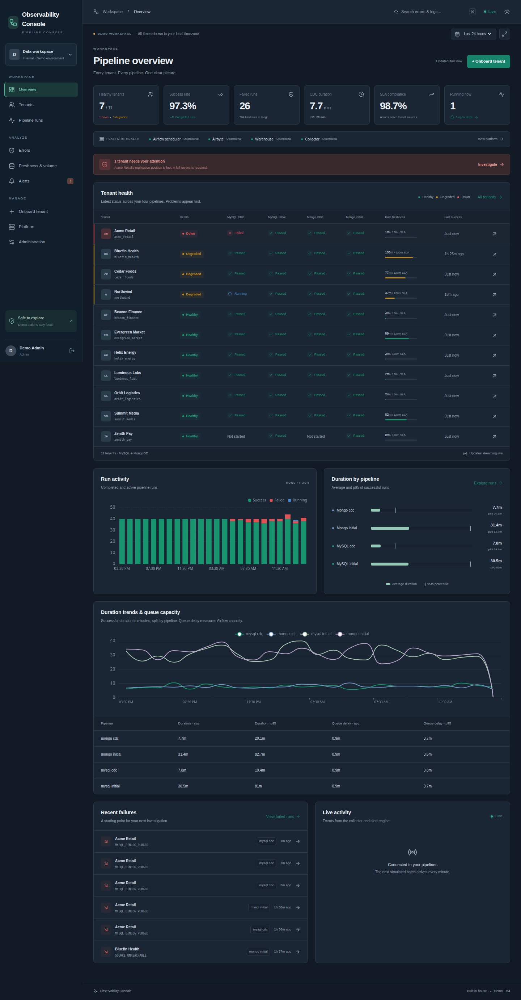](overview-dark.png)

## Mobile

Tenant health and service levels on a narrow viewport.

[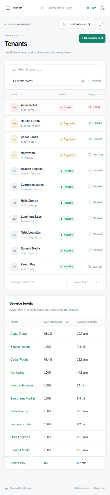](mobile.png)

## Sign in

Local demo accounts with Viewer, Operator, and Admin roles.

